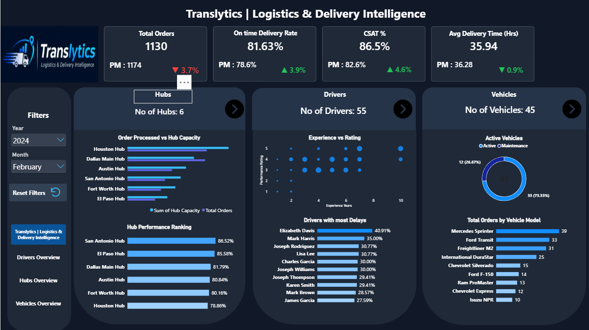

# Translytics – Logistics & Delivery Intelligence Dashboard

## Project Overview
Translytics is an interactive Power BI dashboard designed to analyse logistics and delivery operations. It provides insights into delivery performance, driver efficiency, hub performance, and vehicle utilisation.

The project aims to help businesses monitor operations, identify delivery issues, and make data-driven decisions.

## Objectives
- Analyse overall delivery performance.
- Monitor on-time and delayed deliveries.
- Evaluate driver performance and ratings.
- Compare delivery hub performance.
- Analyse vehicle utilisation.
- Identify opportunities to improve operational efficiency.

## Tools & Technologies
- Microsoft Power BI
- Power Query
- DAX (Data Analysis Expressions)
- Excel / CSV

## Data Cleaning
The dataset was prepared using Power Query. The cleaning process included:
- Handling missing values.
- Identifying duplicate Delivery IDs.
- Checking negative distances and costs.
- Standardising delivery status values.
- Validating delivery delay information.

## Dashboard Features
- KPI cards for overall performance.
- Delivery performance analysis.
- Hub-wise performance analysis.
- Driver performance and ratings.
- Vehicle performance analysis.
- Interactive slicers and filters.

## Key Learnings
- Data cleaning and transformation.
- Creating DAX measures and calculated columns.
- Developing interactive dashboards.
- Data visualisation and business analysis.
- Generating meaningful insights from raw data.

## Dataset
This project uses a sample logistics dataset for learning and analytical purposes.

## Project Created By
Developed as a Data Analytics portfolio project using Microsoft Power BI.

## Dashboard Preview

